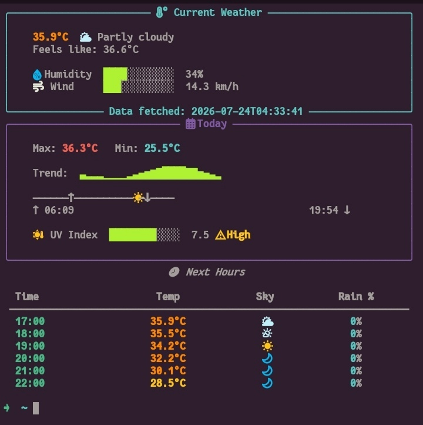
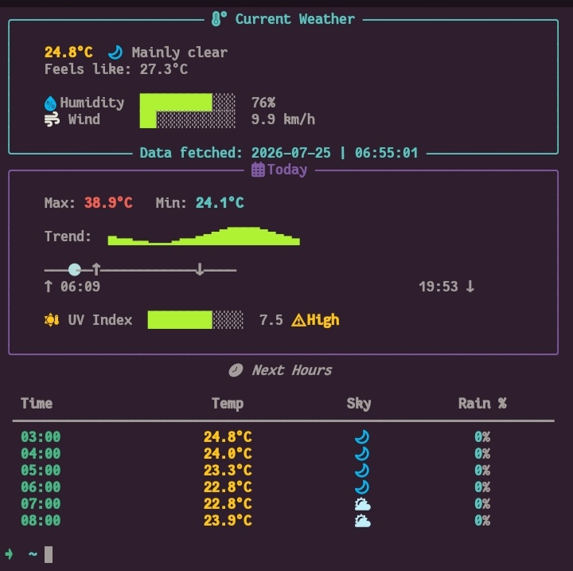

# WeatherCLI

A beautiful terminal weather dashboard built with Python and Rich.






## Features

- Current weather (temperature, feels like, humidity, wind)
- Pick any place by city name - no coordinates to look up (`--city "Cairo"`)
- Multi-day forecast table (sky, min/max temps, rain chance, UV)
- Sunrise & sunset with a 24-hour day-position bar
- UV Index with a color-coded safety level
- Hourly forecast table
- Temperature trend sparkline
- Automatic timezone detection - correct local times for any city on Earth
- Nerd Font icons and colored gauges
- Optional hourly Android notifications (Termux:API)
- Built for Termux (Android), but works anywhere Python 3.9+ runs

## How it works

The project is split into small, independent scripts:

- **`weather.py`** — fetches a 7-day forecast from [Open-Meteo](https://open-meteo.com/) (free, no API key needed) and saves it to `data.json`. Only needs to run once a day.
- **`dashboard.py`** — reads `data.json` and displays it. Safe to run any time; it always computes the current hour's conditions from the saved forecast.
- **`notify.py`** — sends an Android notification with the current conditions. Optional, requires Termux:API.
- **`cli.py`** — a single `weather` command that fetches and then displays (installed by pip/pipx, see below).

## Setup

1. Clone the repo and install dependencies:

```bash
git clone https://github.com/aelalmy45/WeatherCLI.git
cd WeatherCLI
pip install -r requirements.txt
```

2. Fetch the weather for your city:

```bash
python weather.py --city "Cairo"
```

The city name is resolved through Open-Meteo's free geocoding API, and the
forecast's timezone is detected automatically. You can also set how many days
to fetch (1-16, default 7):

```bash
python weather.py --city "Alexandria" --days 3
```

If you'd rather pin exact coordinates (or stay fully offline from the
geocoding API), create a `config.py` file instead - it's gitignored, so your
coordinates never get committed:

```python
LATITUDE = 30.0444
LONGITUDE = 31.2357
```

`--city` wins when both are given. With neither, built-in default coordinates
(Cairo) are used with a warning.

3. Display the dashboard:

```bash
python dashboard.py
```

## Optional: install as a command

The repo is pip/pipx-installable. With [pipx](https://pipx.pypa.io/):

```bash
pipx install git+https://github.com/aelalmy45/WeatherCLI.git
weather --city "Cairo"   # fetch + show the dashboard in one step
```

This installs four commands:

- `weather` — fetch, then display the dashboard
- `weather-fetch` — fetch only (same as `python weather.py`)
- `weather-dashboard` — display only (same as `python dashboard.py`)
- `weather-notify` — send a notification (same as `python notify.py`)

Note for installed (non-clone) usage: `data.json` is stored next to the
installed package, so prefer `--city` over `config.py` there.

## Optional: hourly notifications

Requires the **Termux:API** app (from F-Droid) and package:

```bash
pkg install termux-api
python notify.py
```

## Optional: run it automatically

`weather.py` only needs to run once a day; `notify.py` can run every hour on its own using Termux's built-in job scheduler — no need to keep Termux open:

```bash
pkg install termux-job-scheduler
chmod +x run_weather.sh run_notify.sh

termux-job-scheduler -s $HOME/WeatherCLI/run_weather.sh --job-id 1 --period-ms 86400000 --persisted true
termux-job-scheduler -s $HOME/WeatherCLI/run_notify.sh --job-id 2 --period-ms 3600000 --persisted true
```

The wrapper scripts resolve their own location, so the scheduled jobs work no matter where you cloned the repo - just point `-s` at the script's actual path. To schedule a specific city, edit the wrapper script and add `--city "Your City"` to the python command.

## Project structure

```
WeatherCLI/
├── weather.py         # fetches & saves the forecast (Open-Meteo + geocoding)
├── dashboard.py       # displays the terminal dashboard
├── notify.py          # sends hourly notifications
├── cli.py             # combined `weather` command (fetch + display)
├── config.py          # your coordinates (gitignored, optional)
├── pyproject.toml     # packaging: pip/pipx installable
├── run_weather.sh     # wrapper script for job scheduling
├── run_notify.sh      # wrapper script for job scheduling
└── requirements.txt
```

## Requirements

- Python 3.9+
- [rich](https://github.com/Textualize/rich) and [requests](https://requests.readthedocs.io/)
- A Nerd Font in your terminal (so the icons render correctly)
- Termux:API (optional, for notifications)
